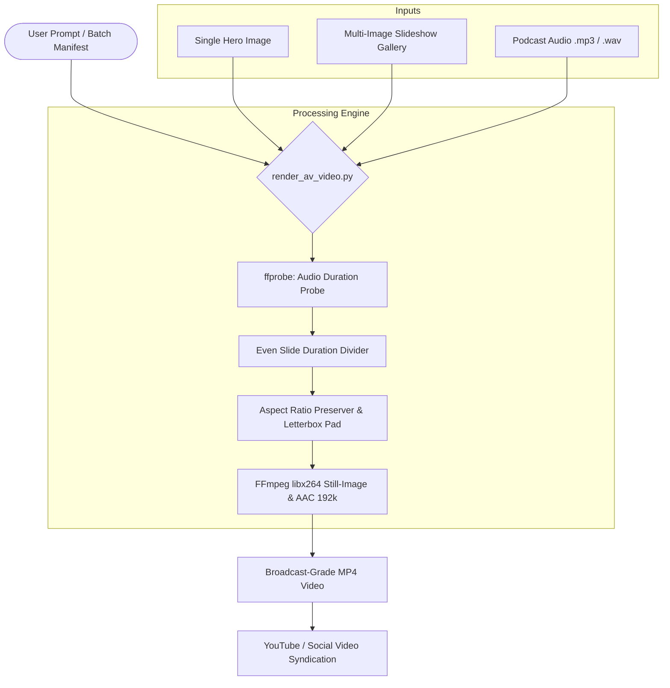

# 🎬 Antigravity Audio-Visual Video Stitcher (`audiovisual-video-stitcher`)

[](https://opensource.org/licenses/MIT)
[](https://www.python.org/)
[](https://ffmpeg.org/)
[](https://github.com/google-gemini)

A portable, cross-platform **Skill & Plugin** for **Google Antigravity CLI** (`agy`) and the command line. It turns audio podcasts, voice monographs, tutorials, talk radio broadcasts, and meditation guides into broadcast-grade `.mp4` videos via FFmpeg with zero third-party Python dependencies.

Supports both **single still-image featured artwork** (using ultra-efficient H.264 still-image tuning) and **dynamic multi-image slideshows** automatically timed and synchronized to speech duration.

---

## 🏛 Architecture



---

## 🌟 Key Features

- **System & Username Agnostic:** Uses dynamic path resolution and relative links. Works out-of-the-box on Linux, macOS, and Windows.
- **Zero Python Dependencies:** Uses only Python standard library modules (`os`, `sys`, `subprocess`, `argparse`, `json`, `pathlib`, `concurrent.futures`).
- **Single Still-Image Tuning:** Applies `-c:v libx264 -tune stillimage -crf 18 -threads 2` to render high-fidelity podcast videos with minimal CPU and tiny file sizes.
- **Automated Slideshow Synchronization:** Probes audio duration via `ffprobe`, calculates $\text{Slide Duration} = \frac{\text{Total Duration}}{\text{Image Count}}$, and stitches images sequentially with concat demuxing.
- **Universal Aspect Ratio Matrix:** Automatically prevents stretching or warping by applying clean letterbox or pillarbox padding.
- **Concurrent Batch Engine:** Includes built-in multi-process worker pool (`--batch manifest.json --workers 2`) for bulk rendering.
- **Antigravity CLI Native:** Fully validated with `agy plugin validate --strict`.

---

## 📐 Aspect Ratio Matrix

| Aspect Ratio | Resolution | Best Suited For | Auto-Padding Behavior |
| :---: | :---: | :--- | :--- |
| **`4:3`** | `1280x960` | Classical art, amulet portraits, botanical monographs | Preserves 4:3 canvas with clean borders |
| **`16:9`** | `1920x1080` | Standard YouTube widescreen, documentary landscapes | Full HD 1080p canvas with auto-pillarboxing |
| **`1:1`** | `1080x1080` | Instagram feed posts, square album artwork | 1:1 square canvas |
| **`9:16`** | `1080x1920` | YouTube Shorts, TikTok, Instagram Reels | Vertical full HD mobile canvas |

---

## 🚀 Installation

### Option 1: Install as an Antigravity Plugin (Recommended)

Clone the repository directly into your global or project plugins directory:

```bash
# Global installation (available everywhere in Antigravity CLI)
git clone https://github.com/AjarnSpencer/agy-audiovisual-video-stitcher.git \
  ~/.gemini/config/plugins/audiovisual-video-stitcher

# Validate plugin
agy plugin validate ~/.gemini/config/plugins/audiovisual-video-stitcher --strict
```

### Option 2: Install as a Workspace Skill

If you want the skill available in a specific project or workspace:

```bash
mkdir -p .agents/skills
git clone https://github.com/AjarnSpencer/agy-audiovisual-video-stitcher.git /tmp/av-stitcher
cp -r /tmp/av-stitcher/skills/audiovisual-video-stitcher .agents/skills/
rm -rf /tmp/av-stitcher
```

### Option 3: Standalone CLI Usage

Clone anywhere and run the script directly:

```bash
git clone https://github.com/AjarnSpencer/agy-audiovisual-video-stitcher.git
cd agy-audiovisual-video-stitcher
python3 skills/audiovisual-video-stitcher/scripts/render_av_video.py --help
```

---

## 🛠 Prerequisites

Requires `ffmpeg` and `ffprobe` installed on your system:

- **Debian / Ubuntu:**
  ```bash
  sudo apt update && sudo apt install -y ffmpeg
  ```
- **macOS (Homebrew):**
  ```bash
  brew install ffmpeg
  ```
- **Windows (winget / Chocolatey):**
  ```powershell
  winget install Gyan.FFmpeg
  # or
  choco install ffmpeg
  ```

---

## 📖 Usage Examples

### 1. Within Antigravity CLI (TUI / Slash Command)

You can invoke the skill directly in natural language or with flags:

```text
/audiovisual-video-stitcher --images hero.jpg --audio podcast.mp3 --output ~/Videos/Episode1.mp4 --aspect 4:3
```

Or ask the agent conversationally:
```text
Stitch my podcast audio at ~/Music/chapter1.mp3 with the 3 images in ~/Pictures/slides/ into a 16:9 MP4 video.
```

### 2. Standalone Terminal Command

#### Single Still-Image Podcast Video (4:3 Portrait)
```bash
python3 skills/audiovisual-video-stitcher/scripts/render_av_video.py \
  --images ~/Pictures/featured_hero.jpg \
  --audio ~/Music/podcast_narration.mp3 \
  --aspect 4:3 \
  --output ~/Videos/Podcast_Episode_01.mp4
```

#### Multi-Image Synchronized Slideshow (16:9 Widescreen)
```bash
python3 skills/audiovisual-video-stitcher/scripts/render_av_video.py \
  --images slide1.jpg slide2.jpg slide3.jpg slide4.jpg \
  --audio voice_track.wav \
  --aspect 16:9 \
  --title "Ancient Temples Monograph"
```

#### Batch Processing via JSON Manifest
```bash
python3 skills/audiovisual-video-stitcher/scripts/render_av_video.py \
  --batch skills/audiovisual-video-stitcher/examples/batch_manifest.example.json \
  --workers 3
```

---

## 📋 Batch Manifest Schema

```json
[
  {
    "title": "Ancient Temple Bells - Episode 01",
    "images": [
      "~/Pictures/temple_entrance.jpg",
      "~/Pictures/bell_tower.jpg",
      "~/Pictures/meditation_hall.jpg"
    ],
    "audio": "~/Music/episode_01.mp3",
    "aspect": "16:9",
    "output": "~/Videos/Ancient Temple Bells - Episode 01.mp4"
  },
  {
    "title": "Botanical Terpene Retrospective",
    "images": [
      "~/Pictures/botanical_plate_01.jpg"
    ],
    "audio": "~/Music/botanical_guide.mp3",
    "aspect": "4:3"
  }
]
```

---

## ⚖️ YouTube Compliance & Safe Syndication

When publishing generated videos to platforms like YouTube:

1. **Category:** Use Category `28` (*Science & Technology*) or `27` (*Education*).
2. **Harm Reduction & Education Notice:** If covering sensitive botanical, herbal, or esoteric traditions, include a prominent educational statement in the description:
   > *Educational & Botanical Documentary: An informational historical retrospective exploring the geographical origin, agricultural evolution, terpene chemistry, and cultural history of [Topic/Entity]. Produced exclusively for botanical, historical, and harm-reduction educational purposes.*
3. **Outbound Linking:** Point links to encyclopedia monographs or educational documentation rather than direct commercial shopping carts.

---

## 📄 License

Released under the [MIT License](LICENSE). Copyright (c) 2026 Ajarn Spencer Littlewood.
